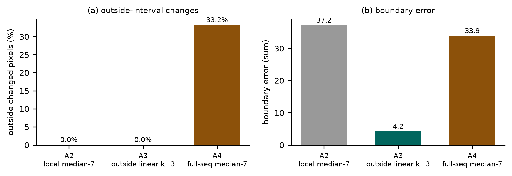
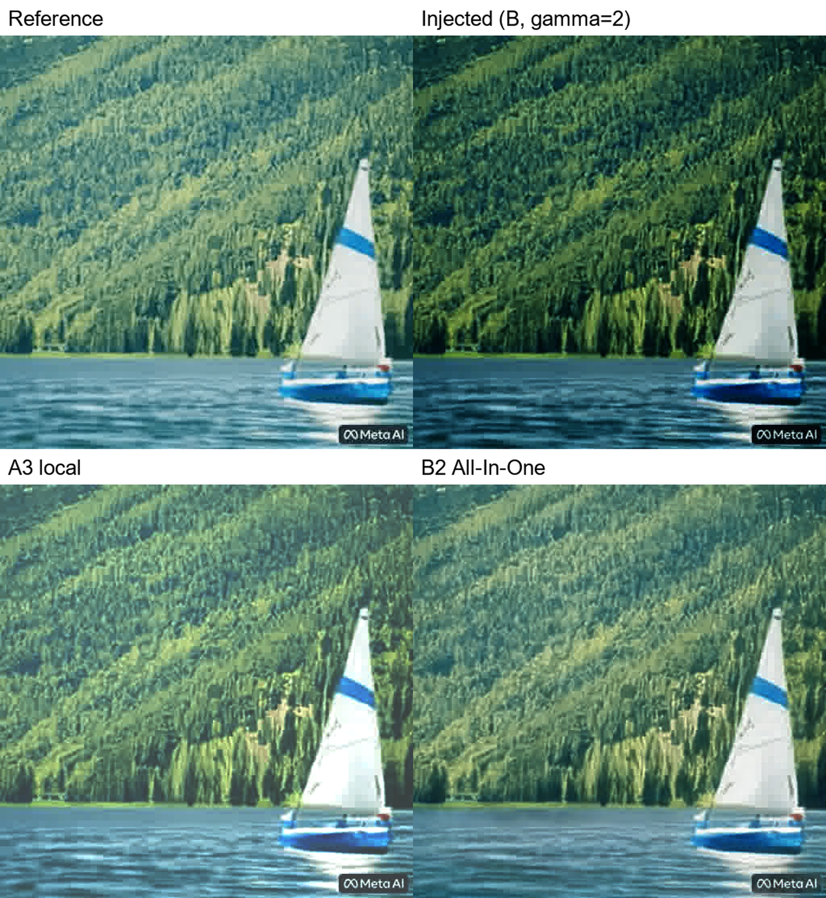

# Local Brightness Correction under Known Intervals: A Controlled Benchmark, Sensitivity Analysis, and Reproducibility Study

**Authors:** [Author Name], [Corresponding Author] (corresponding author)  
**Affiliations:** [Department, University, City, Country]  
**Corresponding email:** [corresponding@example.edu]  
**ORCID:** [0000-0000-0000-0000]

## Abstract

Blind video deflickering methods process a whole sequence and are scored on overall quality, but editing and quality-control pipelines often know, or can verify, the defective interval. We study this known-interval setting as a controlled empirical problem: how accurately can a deterministic corrector restore the interval, what happens outside it, and which corrector should be chosen? We build a reproducible benchmark of 13 sequences, 3 injections (additive offset, gamma 2.0, gamma 1.3), 3 interval lengths and 10 deterministic correctors (1,170 conditions). On all 13 sequences, the outside-linear estimator A3 reduces interval Y-MAE from 19.90 to 2.06/1.48/2.40 for offsets of length 1/4/12. Under gamma 2.0, A3 leaves 8.16/7.65/8.07, whereas a fixed inverse-gamma reference (A7f) reaches 1.46/1.48/1.45 and the adaptive A7 reaches 2.59/1.97/2.95. Local write-back changes 0% of outside pixels; the same estimator with full-sequence write-back changes 33.2%. All-In-One, an open deep blind baseline, reaches 12.48 Y-MAE but rewrites 99.95% of outside pixels. We also report sensitivity, position, edge behaviour, CPU cost and a one-click reproduction package. Detection is deliberately left to the supplement: its held-out recall is 0.744, and natural flicker is not solved. The contribution is a controlled, reproducible reference for a practically relevant but often implicit setting, not a new deflickering network.

**Keywords:** video deflickering; local brightness correction; controlled benchmark; reproducibility; exposure correction

## 1 Introduction

Text-to-video (T2V) generation has advanced rapidly, but temporal consistency remains a weak point: brightness can drift or jump between frames even when the scene content is stable. Such flicker is one of the most visible temporal artifacts in generated and restored video, and it is explicitly targeted by recent blind deflickering methods \cite{qiu2024blazebvd,lei2023blind,duan2024diffsynth}. These methods are *blind*: they are given a flickering video and asked to recover a stable one without knowing which frames are defective, what the defect type is, or how long it lasts. Their natural output is a whole processed video, evaluated by whole-video perceptual or temporal-consistency scores.

Many practical pipelines, however, do not operate blindly. A generation or editing system may know the interval it is about to repair; a quality-control stage may flag a suspicious segment and hand it to a correction module; a user may select a range of frames. In these settings the question is narrower and more demanding: *given the interval*, how accurately can a deterministic estimator restore it, how much does the correction disturb frames outside it, and where does the residual error come from? These questions cannot be answered by whole-video scores, because a method can improve the average temporal consistency while quietly rewriting most of the video.

This paper treats known-interval local brightness correction as a controlled experimental variable. We do not propose a new network. We build a reproducible benchmark, run a matrix of deterministic baselines on real generated-video frames, and report where the simple methods succeed and where they fail. Our contributions are:

1. **A reproducible benchmark.** Thirteen sequences from the VideoDM/Meta subset of the Blind-Video-Deflickering-Dataset (76 frames, 512×512 each), three controlled injections (constant RGB offset, gamma 2, gamma 1.3), three interval lengths (1, 4, 12 frames), ten deterministic correctors, and 1,170 measured conditions. Every frame, configuration, code tree and output is hashed; a one-click package reproduces the tables.
2. **A local-versus-global comparison with a boundary decomposition.** Using the same seven-frame median estimator with local and full-sequence write-back, we show that local write-back changes zero outside pixels while the global variant changes about one third of them and pushes the boundary error from 4.2 to 33.9 on 12-frame intervals. The boundary error is split into estimator bias and outside jump, so the two failure sources are not conflated.
3. **A clipping attribution for gamma defects.** Gamma injection does not clip at injection time, but the correction that pulls brightness back does: the single-frame clipped-channel fraction is 4.53% / 5.38% / 3.43% on sailboat / book / horse. The gamma-1.3 control reduces it to 1.79% / 3.18% / 1.28% and the residual error falls in step. We also show that gamma-aware baselines (adaptive gamma, histogram specification) remove most of this residual, so the correct statement is "within the additive-offset family the residual is clipping-dominated", not "no method can avoid it".
4. **An external deep blind baseline.** The official All-In-One model reduces interval error by 60.4% relative to no-op, but is 2.58× worse than local write-back and changes 99.95% of the outside pixels. This is not a SOTA ranking; it shows that a blind global method and a known-interval local method optimise different objectives.

5. **A reproducible audit trail.** Every frame, configuration, code tree and output is hashed; 37 unit tests and 37 frozen headline checks pass, and a one-click package reproduces the tables. Detection, natural-clip annotation and end-to-end propagation are reported in the Supplementary Material, including the negative detection result (0.744 held-out recall, 0/19 natural flicker clips).

The paper is intentionally an empirical and reproducibility study. Its value lies in the controlled comparison, the boundary results and the audit trail, not in a claim of state-of-the-art quality.

## 2 Related Work

### 2.1 Blind video deflickering

Classical deflickering corrected intensity flicker in archived film \cite{vanroosmalen1999correction} and stabilised flicker-like effects through local contrast correction \cite{delon2010stabilization}. Scale-time equalization (STE) treats flicker as a temporal instability of the frame histogram and equalizes it in a scale-time framework \cite{delon2006movie}. Later work used adaptive post-processing \cite{gandam2021efficient} and temporal reconstruction \cite{li2019video}. Learning-based BVD reconstructs a clean temporal atlas with neural filtering \cite{lei2023blind}, performs latent in-iteration deflickering for generated video \cite{duan2024diffsynth}, or removes flicker-banding with latent diffusion \cite{zhu2025rifle}. BlazeBVD \cite{qiu2024blazebvd} revisits STE and extracts deflickering priors (filtered illumination maps, exposure maps and flickering-frame indices) that guide a 2D restoration network and a lightweight 3D consistency network.

These methods process the whole sequence and optimise whole-video quality. Our setting differs in two ways: the defect interval is known, and the objective explicitly includes not changing frames outside it. The two settings are complementary rather than competing; a blind method can be applied to an interval, but it is not designed to preserve the rest of the video.

### 2.2 Exposure and brightness correction

Image exposure correction evolved from dual-illumination estimation \cite{zhang2019dual} to region-aware models \cite{liu2024region}, transformers \cite{li2023fearless}, CLIP-guided supervision \cite{huang2025clip} and diffusion priors \cite{li2026high}. Video-specific work adds temporal consistency \cite{dong2015temporally,vo2012temporal,petrova2009unsupervised}, including large-scale real-world video exposure correction \cite{zhang2026learning}; recent state of the art includes OSMamba \cite{li2025osmamba} and ECMamba \cite{dong2024ecmamba}. Gamma- and saturation-aware correction \cite{kim2025agcsnet} is directly relevant to the clipping analysis in Section 4.3.

The closest settings to ours are temporally consistent region-based video exposure correction \cite{dong2015temporally} and temporal exposure-inconsistency correction for CMOS video \cite{vo2012temporal}. Their "local" is spatial, however, whereas ours is a temporal interval. We therefore avoid the unqualified word "local" and write "temporal-interval local write-back" where ambiguity is possible.

### 2.3 Temporal consistency in text-to-video generation

Temporal consistency in video generation has been surveyed recently \cite{yin2026survey,einabadi2026survey}. Classical blind temporal consistency \cite{bonneel2015blind}, self-supervised coherence for GAN-based video generation \cite{chu2020learning}, adaptor-based consistency for diffusion video editing \cite{song2025efficient} and temporal consistency for low-light video enhancement \cite{zhang2021learning} address related but distinct failure modes. Flicker is one of the artifacts that these lines of work try to suppress; our controlled injection can be read as a known-interval stress test for the same problem.

### 2.4 Tone mapping, quality metrics and flicker measurement

Tone mapping must be temporally coherent for HDR video \cite{aydin2014temporally,oskarsson2016temporally}, and flicker-free tone mapping has been studied explicitly \cite{mujtaba2022efficient}; evaluation protocols for tone-mapped video are discussed by Eilertsen et al. \cite{eilertsen2013evaluation}. For quality, we use SSIM \cite{wang2004image}, the illumination histogram consistency metric (IHCM) \cite{chen2024illumination} and the temporal visual masking of local flicker \cite{choi2018video}. Flicker measurement has also been studied in coded-video and display contexts \cite{lim2010measurement,yang2008effective}, and neural flicker detection has been attempted \cite{patel2018effective}; recent work also analyses temporal artifacts in AI-generated video \cite{d2026temporal}.

## 3 Method

### 3.1 Problem setting and notation

Let a video be a sequence of RGB frames $I_0,\dots,I_{N-1}$ with $N=76$ and spatial size $512\times512$. A defect interval is a zero-based, half-open range $[s,e)$; throughout, $s=30$ and $e=s+\ell$ with $\ell\in\{1,4,12\}$. A correction method receives the injected sequence $\hat I$ and the interval, and returns an output sequence $O$. It is not given the clean reference $I$.

The quantities used below are defined as:

1. Offset injection: $\hat I = \mathrm{clip}(I - 20, 0, 255)$.
2. Gamma injection: $\hat I = 255\,(I/255)^{\gamma}$, with $\gamma=2$ or $1.3$.
3. Local target: for each frame $t$, fit $y_t = a + b t$ on the clean context frames and use $\hat y_t$ as the target luma.
4. Outside change: $\mathrm{OutFrac} = \frac{1}{|\Omega|}\sum_{x\in\Omega} [O(x)\neq I(x)]$, where $\Omega$ is the outside region.
5. Interval error: $\mathrm{Y\text{-}MAE} = \frac{1}{|\mathcal{I}|}\sum_{t\in\mathcal{I}} |Y(O_t)-Y(I_t)|$, with $Y$ the luma channel.

We evaluate three regions separately: the interval, the outside, and the two boundaries. This decomposition is the core of the evaluation; a single whole-video number hides exactly the trade-off we care about.

### 3.2 Controlled injection

Two injection families are applied only inside $[s,e)$:

- **A (constant offset):** $\hat I = \mathrm{clip}(I-20,0,255)$ on all three RGB channels.
- **B (gamma code-value transform):** $\hat I = 255\,(I/255)^{\gamma}$ with $\gamma=2$.
- **B′ (gamma control):** the same with $\gamma=1.3$.

Gamma is applied to code values, not to physical display luminance; we use the term "gamma code-value transform" throughout. The injection stage records its own clipped-channel fraction before clamping. For A, 0.60%–2.93% of channels clip at the lower bound; for B and B′, injection clipping is zero because the transform darkens.

### 3.3 Deterministic baselines A1–A9

All baselines are deterministic and CPU-only; each is applied to the injected sequence and writes back only the interval unless stated otherwise.

- **A1 No-op.** Identity; lower bound.
- **A2 Local median-7.** The target luma of each interval frame is the median of a centred seven-frame window of the injected sequence; a per-frame additive RGB offset matches the frame mean to that target.
- **A3 Outside linear $k{=}3$ (proposed).** A least-squares line is fitted to the mean luma of three clean frames on each side of the interval and evaluated inside it; the same additive offset is applied. This is the main method inherited from the prior project and the one we analyse most.
- **A4 Full-sequence median-7.** The A2 estimator, but the offset is applied to every frame, including the outside. It isolates the effect of write-back scope.
- **A5 STE-style histogram specification.** The interval frame's luma histogram is mapped to the median histogram of the clean context frames, and the luma difference is written back additively. This is a CPU approximation of the STE idea \cite{delon2006movie}, not the official BlazeBVD implementation.
- **A6 CLAHE.** Contrast-limited adaptive histogram equalization on luma with $8\times8$ tiles and clip limit 2.0 \cite{zuiderveld1994contrast}.
- **A7 Adaptive gamma.** A per-frame gamma is solved so that the mean of $255(y/255)^\gamma$ matches the A3 target luma; the tone curve is applied to luma and written back as a luma difference.
- **A7f Fixed inverse gamma 2.** The same but with a fixed $\gamma=1/2$.
- **A8 Temporal bilateral.** A seven-frame bilateral filter along time, guided by the window median, writes back the interval \cite{tomasi1998bilateral}.
- **A9 Kalman/RTS luma stabilisation.** A 1-D random-walk Kalman filter treats the interval as missing observations and a Rauch–Tung–Striebel smoother estimates the luma trend \cite{kalman1960new}; the offset follows the smoothed trend.

### 3.4 Proposed local write-back

A3 estimates the clean luma trend from context and applies a per-frame additive offset to RGB. The offset is constant across pixels, so chromaticity is preserved exactly and the only nonlinearity is the final clamp to $[0,255]$. For A this offset is approximately $+20$ and recovers the frame exactly except where the injection clipped dark pixels; for B the required offset is much larger and the clamp removes highlight headroom, which is the source of the residual analysed in Section 4.3.

The estimator is deliberately simple: the paper's claim is not that $k{=}3$ is optimal (Section 4.7 shows $k{=}1$ is often better), but that this family makes the interval/outside/boundary trade-off measurable.

### 3.5 Detection (supplementary)

Detection is outside the minimal claim set: the main experiments assume the interval is known. The full detector study (1,300 conditions, Eq. (5) reimplementation, CUSUM, scan and multi-interval variants), the natural-clip annotation (100 clips, single annotator, no kappa) and the end-to-end propagation analysis are reported in the Supplementary Material. For transparency, the held-out CUSUM recall is 0.744 and natural flicker is not solved; neither is used as a main contribution.

### 3.6 Metrics

For each frame and region we compute:

- **Y MAE** and **RGB MAE** against the clean reference;
- **PSNR** on RGB and **SSIM** on luma with a $9\times9$ uniform window;
- **Histogram distance**: total-variation distance between 64-bin luma histograms, a discrete proxy for IHCM \cite{chen2024illumination};
- **OutFrac**: fraction of pixels outside the true interval that change at all, and **outside RGB MAE** to measure the magnitude of the change;
- **Boundary error**: the sum of the left and right luma-jump errors, decomposed into *estimator bias* (level error on the two boundary frames inside the interval) and *outside jump* (level error on the two frames immediately outside);
- **Flicker proxies**: variance of first differences and RMS of second differences of mean luma on the interval plus two context frames.

### 3.7 Statistics and reproducibility

We report per-video means with a cluster bootstrap over the 13 videos (2,000 resamples, percentile interval). Paired comparisons use the exact sign-flip distribution of the Wilcoxon signed-rank statistic for the 13 video-level differences, with Holm correction across the tested family; frame-level Wilcoxon $p$-values are reported only as descriptive because frames within a video are not independent.

Every run records a canonical JSON configuration hash, a code-tree hash, the Python/NumPy/Pillow versions, the command line, and SHA-256 of every frame and output table. A validator re-executes a deterministic sample of conditions and recomputes the metrics. The final headline numbers are frozen in a JSON file with 37 checks; the paper only quotes values that pass the freeze.

## 4 Experiments

### 4.1 Setup

The corpus is the VideoDM/Meta subset of the Blind-Video-Deflickering-Dataset (CC BY 4.0), 13 sequences × 76 frames × 512×512 RGB. The three development sequences used by the prior project are book, horse and sailboat; the remaining ten form the expansion set. The archive SHA-256 is `737252c0…0626e`; every frame is hashed in the manifest.

The correction matrix is 13 sequences × 3 injections × 3 lengths × 10 methods = 1,170 conditions, taking 44.7 minutes on one CPU core. Detection, natural-clip annotation and end-to-end propagation are reported in the Supplementary Material. B2 runs on thirty-nine injected cases on an RTX 5060 Laptop 8 GB.

### 4.2 RQ1: interval reconstruction

Table 1 reports the interval Y-MAE over all 13 sequences. Under A, A3 reduces the no-op error from 19.90 to 2.06 / 1.48 / 2.40 for lengths 1 / 4 / 12. Under B, A3 leaves 8.16 / 7.65 / 8.07, A7 reduces this to 2.59 / 1.97 / 2.95, and the gamma-known A7f reaches 1.46 / 1.48 / 1.45. Under B′, A7 is best (2.11 / 1.48 / 2.50) and A5 is close (2.12 / 1.97 / 3.16).

**Table 1.** Interval Y-MAE over all 13 sequences (lower is better; mean of 13). The full 10-method matrix is in Supplementary Table S1.

| Method | A: 1 / 4 / 12 | B: 1 / 4 / 12 | B′: 1 / 4 / 12 |
|---|---|---|---|
| A1 No-op | 19.90 / 19.89 / 19.90 | 53.62 / 53.68 / 54.02 | 20.49 / 20.54 / 20.63 |
| A2 Local median-7 | 2.29 / 18.26 / 19.52 | 8.55 / 52.05 / 53.66 | 4.18 / 18.83 / 20.26 |
| A3 Outside linear k=3 | 2.06 / 1.48 / 2.40 | 8.16 / 7.65 / 8.07 | 3.92 / 3.20 / 4.03 |
| A4 Full-seq median-7 | 2.29 / 18.26 / 19.52 | 8.55 / 52.05 / 53.66 | 4.18 / 18.83 / 20.26 |
| A5 STE histogram | 2.02 / 1.87 / 3.09 | 2.53 / 2.40 / 3.52 | 2.12 / 1.97 / 3.16 |
| A7 Adaptive gamma | 3.37 / 3.25 / 3.81 | 2.59 / 1.97 / 2.95 | 2.11 / 1.48 / 2.50 |
| A9 Kalman/RTS | 2.14 / 1.98 / 3.42 | 8.35 / 8.17 / 8.75 | 3.93 / 3.79 / 4.77 |

Table 1 uses all 13 sequences, not a development subset. Under A, A3 is the best corrector (2.06/1.48/2.40), but A5 is slightly better at length 1 (2.02). Under B, A3 leaves about 8, A7 reduces this to 2.59/1.97/2.95, and the gamma-known reference A7f reaches 1.46/1.48/1.45. Under B′, A7 is best (2.11/1.48/2.50) and A5 is close (2.12/1.97/3.16). A3 is therefore not universally best, and A7 is not the universal gamma solution: the correct choice depends on the injection family and on whether the gamma is known.

### 4.3 Clipping attribution under gamma

The residual under B is not caused by injection clipping: the gamma transform darkens, so no channel exceeds 255 at injection. The correction, however, adds a large positive offset to bring the frame mean back; highlights then hit the upper bound. The single-frame clipped-channel fraction of A3 is 4.53% on sailboat, 5.38% on book and 3.43% on horse. The gamma-1.3 control reduces the required offset and the clipping to 1.79% / 3.18% / 1.28%, and the residual falls from 6.99 / 9.94 / 9.03 to 3.72 / 4.24 / 3.38.

A tanh shoulder starting at 235 removes the hard clipping entirely (2.57% → 0.00% on the B length-1 case) but improves Y-MAE only from 8.164 to 8.117 and PSNR from 27.07 to 27.17 dB. The information removed by the clamp is not recovered by compressing it. This is why the paper says "the residual of the additive-offset family is clipping-dominated", and why gamma-aware methods that avoid the large offset do better.

### 4.4 RQ2: local versus full-sequence write-back

Table 2 compares A2 and A4, which share the same seven-frame median estimator and differ only in write-back scope, and A3 as the context-based counterpart. On 12-frame intervals under A, A2 and A3 change no outside pixels, while A4 changes 33.2% of them and leaves an outside RGB MAE of 0.91. The boundary error is 4.23 for A3, 37.20 for A2 and 33.89 for A4; the decomposition shows that A4's error is almost entirely estimator bias (33.9), not outside jump (3.3). In other words, the global variant does not merely "jump" at the boundary: it moves the boundary frames themselves because the contaminated median leaks outside. The paired A3-versus-A4 difference is −0.335 in outside changed fraction (95% CI −0.433 to −0.252, exact $p=2.4\times10^{-4}$), and the 4- and 12-frame boundary differences are −31.3 and −29.7.

**Table 2.** Local vs. full-sequence write-back: outside preservation and boundary decomposition (A, 12-frame intervals, 13 sequences).

| Method | OutFrac (A, 12) | Outside RGB MAE | Boundary | Estimator bias | Outside jump |
|---|---|---|---|---|---|
| A2 Local median-7 | 0.00% | 0.00 | 37.20 | 37.20 | 0.00 |
| A3 Outside linear k=3 | 0.00% | 0.00 | 4.23 | 4.23 | 0.00 |
| A4 Full-seq median-7 | 33.2% | 0.91 | 33.89 | 33.89 | 3.31 |

### 4.5 Detection boundary (supplementary)

The held-out CUSUM detector reaches 0.744 recall and 0.641 precision on the nine test sequences, and the natural-clip check detects 0/19 flicker clips. Both results are reported in full in the Supplementary Material. They define the boundary of the present contribution: the correction benchmark assumes a known interval, and the detector is not claimed to be a solution.

### 4.6 B2: a deep blind baseline under the same constraint

We run the official All-In-One code and weights on thirty-nine injected cases (512×512, 10,001 iterations, downsample 4; stage 1 about 8.7 minutes per case, stage 2 about 11 seconds). Table 4 compares no-op, A3 and B2 on the true interval and outside it.

**Table 3.** Deep blind baseline (All-In-One) vs local write-back on thirty-nine injected cases.

| Method | A | B | B′ | Overall | OutFrac | Outside RGB MAE | Boundary |
|---|---|---|---|---|---|---|---|
| No-op | 19.90 | 54.02 | 20.63 | 31.52 | 0.00% | 0.00 | 62.96 |
| A3 local k=3 | 2.40 | 8.07 | 4.03 | 4.84 | 0.00% | 0.00 | 4.40 |
| B2 All-In-One | 9.19 | 18.56 | 9.69 | 12.48 | 99.95% | 9.79 | 4.29 |

B2 reduces interval error by 60.4% relative to no-op, but it is 2.58× worse than A3 (paired difference 7.65 Y-MAE, 95% CI 6.19-9.25, sign-flip Monte Carlo p=5e-5) and changes essentially every outside pixel (Figure 3).

 The full 117-case matrix (including lengths 1 and 4) is reported in the supplement: under A, B2 reaches 7.79/7.39/9.19 Y-MAE for lengths 1/4/12 versus 2.06/1.48/2.40 for A3; under B it degrades from 8.94 to 18.56 while A3 stays at 8.16/7.65/8.07. The gap therefore grows with interval length, especially under gamma. On the 52 two-interval cases, B2 reaches 13.37 Y-MAE versus 5.16 for A3 and 3.20 for A7, with 99.95% of outside pixels changed; the same task mismatch holds for multiple intervals. On 26 three-interval cases, B2 is 12.83 Y-MAE versus 3.51 for A3 and 3.31 for A7, with 99.98% outside changes; mixed and all-A scenarios show the same ordering. A four-interval stress test keeps the correction stable (A3 3.21, A7 2.77 under mixing; A3 1.58 under all-A) but CUSUM recall remains 0.62/0.54 with per-interval hits 0.54-1.00. B2 on the 13 four-interval cases gives 11.98 Y-MAE versus 3.21/2.77, with 99.98% outside changes and a boundary error of 11.58 versus 10.25/10.03; the deep blind baseline is now worse on every axis. The multi-span scan does not scale to four intervals either: test recall 0.769, precision 0.497, and only 2.8 spans on average for four true intervals.

Its boundary error is slightly lower on 20 of 39 cases, because a global filter smooths the transition; that smoothness is bought by rewriting the whole video. The comparison is not a SOTA ranking: B2 is blind and is not asked to preserve an interval. It is evidence that a deep blind method and a known-interval local method optimise different objectives.

### 4.7 Sensitivity, position and ablations

**Write-back scope.** A2 versus A4 is the clean ablation: same estimator, different scope. The global variant changes 33.2% of outside pixels and pushes the 12-frame boundary error from 37.20 (A2, already failing inside) to 33.89 (A4), while A3 remains at 4.23. Scope is not a cosmetic choice.

**Context size.** Table 4 shows that $k=1$ is often better than $k=3$: on A length 12 the Y-MAE is 1.93 for $k=1$, 2.40 for $k=3$ and 2.64 for $k=5$; on B length 12 it is 7.89, 8.07 and 8.21. The brightness curve is closer to a random walk than to a line, so distant context adds slope bias. We keep $k=3$ as the prior project's method for comparability and report this as a negative result for the "more context is better" assumption.

**Table 4.** Sensitivity of the offset estimator to the context window k for the offset estimator (mean over 13 sequences).

| k | A: 1 / 4 / 12 | B: 1 / 4 / 12 |
|---|---|---|
| 1 | 1.67 / 1.19 / 1.93 | 8.13 / 7.66 / 7.89 |
| 3 | 2.06 / 1.48 / 2.40 | 8.16 / 7.65 / 8.07 |
| 5 | 1.68 / 1.49 / 2.64 | 8.04 / 7.74 / 8.21 |

**Interval position.** Moving the len12 interval to start 10/30/50 changes A3 from 1.91 to 2.59 (A), 8.63 to 8.07 to 8.19 (B) and 3.83 to 4.25 (B′); A7 grows from 3.47 to 4.15, 2.42 to 3.17 and 1.97 to 2.67 over the same starts. The position effect (about 0.5-0.7 Y-MAE) is smaller than the gaps between methods, so it does not change the ranking. At the sequence edges the picture changes: a len1 interval at start 0 gives A3 9.41 Y-MAE versus 2.06 in the middle, and a len12 interval ending at frame 76 gives 6.49 versus 2.40; A3 needs bilateral context, so we also test an edge-aware variant A3e that extrapolates from the available side: at start 0 it reduces len1/len4 A-injection error from 9.41/7.56 to 3.06/1.56, and at an interval ending on the last frame it reduces len12 B error from 13.90 to 10.83. A3e still does not reach the mid-sequence level (2.06/1.48 and 8.07), so edge-aware extrapolation is a mitigation rather than a solution.

**Injection strength.** A separate sweep (13 sequences, len12, 1,365 conditions) varies the offset over −10/−20/−30 and gamma over 1.3/1.5/2.0/2.5. A3 stays at 2.38-2.61 Y-MAE across the three offsets, while A2 grows from 9.61 to 29.35; under gamma 1.3-2.5 A3 grows from 4.03 to 10.73, while A7 stays at 2.50-3.38. The clipping fraction of A3 rises from 0.80% to 2.46%, versus 0.12% to 0.71% for A7, consistent with the attribution above. The sweep is reported in the supplementary material.

**Clipping compensation.** The tanh shoulder removes clipping but recovers only about 0.05 Y-MAE; see Section 4.3.

**D2 components.** On length 12, dual threshold and gap merging do not help; boundary refinement actually hurts (recall 0.400 with refinement versus 0.500 without), because snapping to the strongest luma change is pulled by natural flicker. On length 4, D2 improves precision from 0.265 to 0.345 and recall from 0.853 to 0.929. Intervalisation helps short and medium segments, not the sustained ones.

### 4.8 Reproducibility checks

Thirty-seven unit tests cover injection, correction, metrics, detection, statistics and provenance. A validator re-executes a deterministic sample of the matrix and recomputes per-frame errors and interval hashes (12/12 PASS). The final freeze checks 37 headline numbers against the source CSVs and the report text; all pass. The one-click package runs the tests and the freeze inside the package directory and passes. The package contains about 440 files (47 MB) and excludes only the 2.4 GB raw frames and the third-party weights, both available from their official sources.

## 5 Discussion

### 5.1 Why local write-back matters

The A2/A4 ablation isolates scope from estimator quality. A global seven-frame median changes about one third of the outside pixels and moves the boundary frames themselves, because the median at the edge is contaminated by the defect. A local method with the same estimator changes none. If a pipeline's contract is "repair this interval and leave the rest alone", scope is a first-class design choice, not an implementation detail. The boundary decomposition makes the cost visible: A4's error is estimator bias (33.9), not an outside jump (3.3).

### 5.2 Scope and practical selection

The practical question is not "which corrector is best" but "which corrector fits the interval and the available side information". For an additive offset with a reliable interval, A3 is the natural default (2.06/1.48/2.40) and costs about 22 ms per frame. If the gamma is known to be 2.0, the fixed inverse-gamma reference A7f is clearly better (1.46/1.48/1.45); if the gamma is unknown but the defect is gamma-like, A7 (2.59/1.97/2.95) is preferable to A3. For the weaker gamma 1.3, A7 (2.11/1.48/2.50) and A5 (2.12/1.97/3.16) are both reasonable, while A7f is unusable (about 32). When the interval is uncertain, the ranking changes: A5 is the most robust choice, and A3 loses much of its advantage. A3e mitigates edge cases (start 0: 9.41 to 3.06 for length 1) but does not fully close the gap. This selection table, rather than a single SOTA number, is the practical output of the study.

### 5.3 The deep baseline optimises a different objective

B2 reduces flicker but rewrites the video. Under the task constraint "do not change the outside", it is not a competitor to local write-back; it is a different point on the trade-off. Reporting it as a SOTA comparison would be misleading in both directions. The value of the B2 experiment is to show that the gap between "blind global" and "known-interval local" is large and measurable, and that the choice depends on the contract of the pipeline.

### 5.4 Limitations

The scope is deliberately narrow. The benchmark contains 13 sequences from one public subset and synthetic injections; it does not establish correction accuracy on natural defects. The natural-clip study is single-annotated, has no kappa and only evaluates detection, not correction. Detection remains unsolved (0.744 held-out recall; 0/19 flicker clips). B2 is the only open deep baseline, and B1/B3-B5 were unavailable. The cost, edge and multi-interval results are included to show where the conclusions stop, not to claim generality.

The study has clear limits. The corpus has 13 sequences, all from one dataset subset; the expansion target of 15 sequences was not met because the subset contains only 13. The defects are synthetic, not naturally occurring; the real T2V annotation study was not completed because the public archive does not identify the generating model or prompt and the natural brightness variation is continuous rather than a single bounded interval. The injection uses code-value gamma rather than physical display gamma. The detector's held-out recall is 0.744 and the end-to-end outside changed fraction is 4.01%, both below our targets. B1 BlazeBVD could not be run because its official code is not publicly released; B3–B5 were not run because weights were unavailable. The B2 run uses 512×512 instead of the official 768×432 and torch 2.11 instead of the official 1.12, so it is a faithful forward pass, not a bit-exact reproduction. Finally, the cluster bootstrap has only 9-14 clusters; the intervals are wide (for example the test recall interval is 0.485-0.982) and descriptive, not a substitute for a large-sample study.

## 6 Conclusion

We presented a reproducible, controlled study of local brightness correction for known defect intervals in generated video. The benchmark separates interval error, outside preservation and boundary error; it shows that a simple outside-linear offset removes most of a constant-offset defect, that the gamma residual of this family is clipping-dominated, and that gamma-aware baselines remove most of that residual. The same estimator with global write-back changes about one third of the outside pixels, which quantifies the cost of ignoring scope. The detection study reproduces BlazeBVD Eq. (5), shows why its smoothed baseline misses sustained intervals, and reports a held-out recall of 0.744 rather than an optimistic all-sequence number. A deep blind baseline reduces interval error but rewrites the video, confirming that the two settings optimise different objectives. The contribution is a reproducible empirical benchmark and a set of honest boundary results, not a new state-of-the-art network.

## Statements and Declarations

**Funding:** The authors received no specific funding for this work.

**Competing interests:** The authors have no relevant financial or non-financial interests to disclose.

**Ethics approval:** This study used a public dataset (CC BY 4.0); no ethical approval was required.

**Consent to participate:** Not applicable.

**Consent for publication:** Not applicable.

**Data availability:** The dataset is publicly available from the Blind-Video-Deflickering-Dataset repository (VideoDM/Meta subset, CC BY 4.0). The code, configurations, frozen tables and reproduction package are available at https://github.com/BL8914489-A11y/luma-corr; the package contains per-frame hashes and a one-click test.

**Author contributions:** [Author Name] conceived the study, implemented the code, ran the experiments and wrote the manuscript. [Corresponding Author] supervised the work and revised the manuscript. All authors read and approved the final manuscript.

**Use of AI tools:** [If applicable, state tool and purpose; otherwise: The authors did not use generative AI tools to draft the manuscript.]
